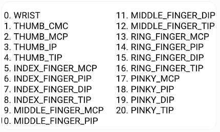
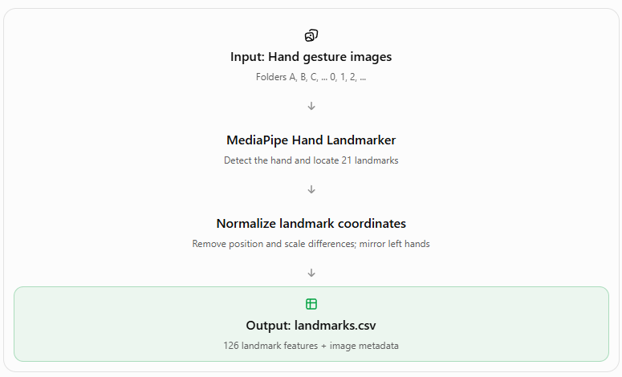

Mediapipe approach: 
 
 
 
MediaPipe detects 21 key points on a hand, including the wrist, finger joints, and fingertips. 
 
Each landmark has three coordinates: 
- x: Horizontal position. 
- y: Vertical position. 
- z: Relative depth of the landmark. 
The model predict a hand gesture base on the landmark instead of hand shape. 
 
Python Files: 
 
 
extract_landmarks.py - uses MediaPipe to detect and extract 21 hand landmarks from gesture images, normalizes their coordinates, and saves them to a CSV file for training hand gesture classification models.  
 
 
capture_hands.py - functions for capturing a hand in a boundery box when it detect on Camera  
data_splitting.py - pre-processing raw dataset, run this before training a model. Split dataset into 3 train, valid & test. Change dir if need. 
model.py - get NetMobile-smallv3 model 
train_mediapipe.py - train model with the dataset in the folder. Check dir before traning & make sure it pointing to the correct dataset. 
model_mlp.py- simple MPL model 
webcame_Mediapipe.py - main file, use camera to capture the hand gesture then use model to give a prediction. Currently set to return top 5 predictions for testing purpose.  
gesture_mlp.pth- trained model using the org data set 
hand_landmarker.task - use for mediapipe to capture human hand.  
 
 
Set up: 
Download the data set from: 
https://data.mendeley.com/datasets/j4y5w2c8w9/1- 
 
 
Step: 
You can train your own by: 
 
Run data_splitting.py to split the dataset and shuffle them.  
Run train_mediapipe.py to create the CSV file first. 
Run train_mediapipe.py to train the model. 
 
(Or download the gesture_mlp.pth instead) 
 
Run webcame_Mediapipe.py to use live camera and test the prediction.  

